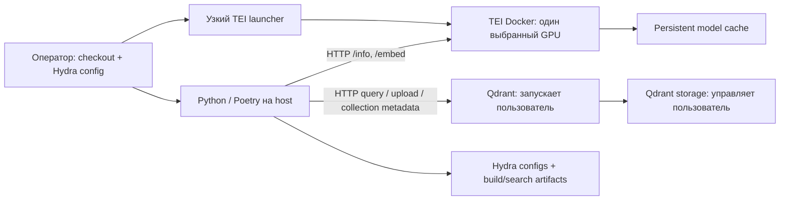
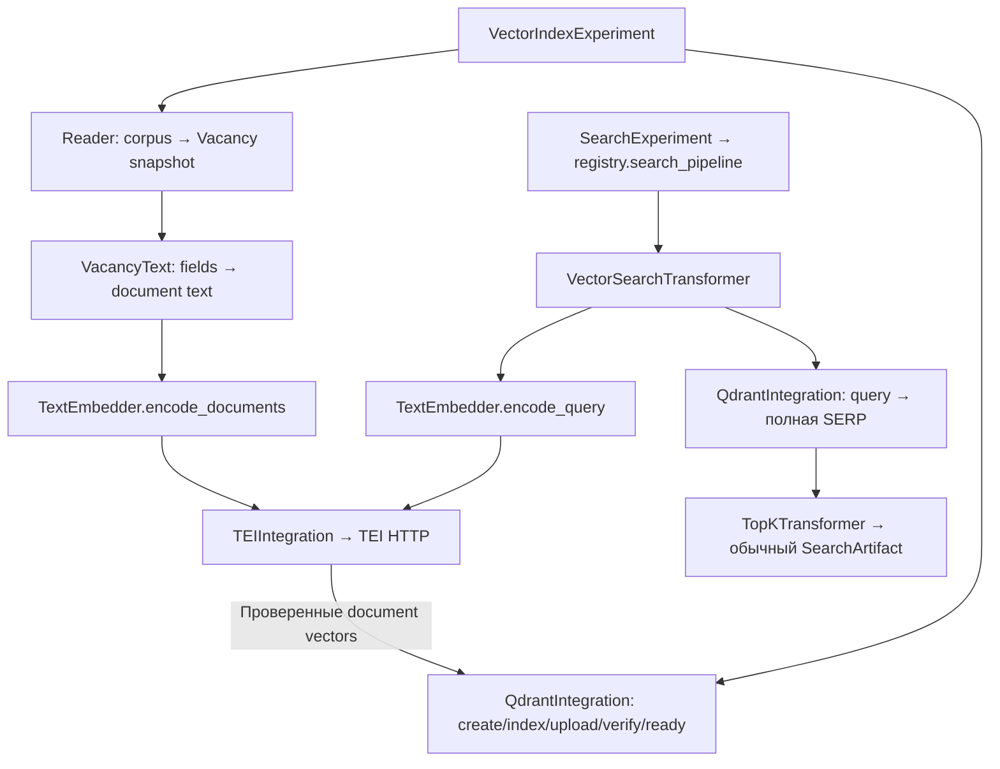
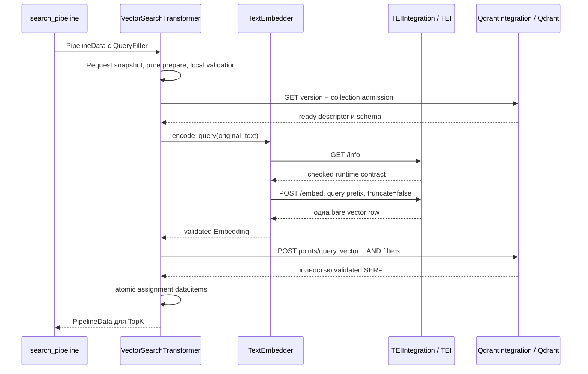
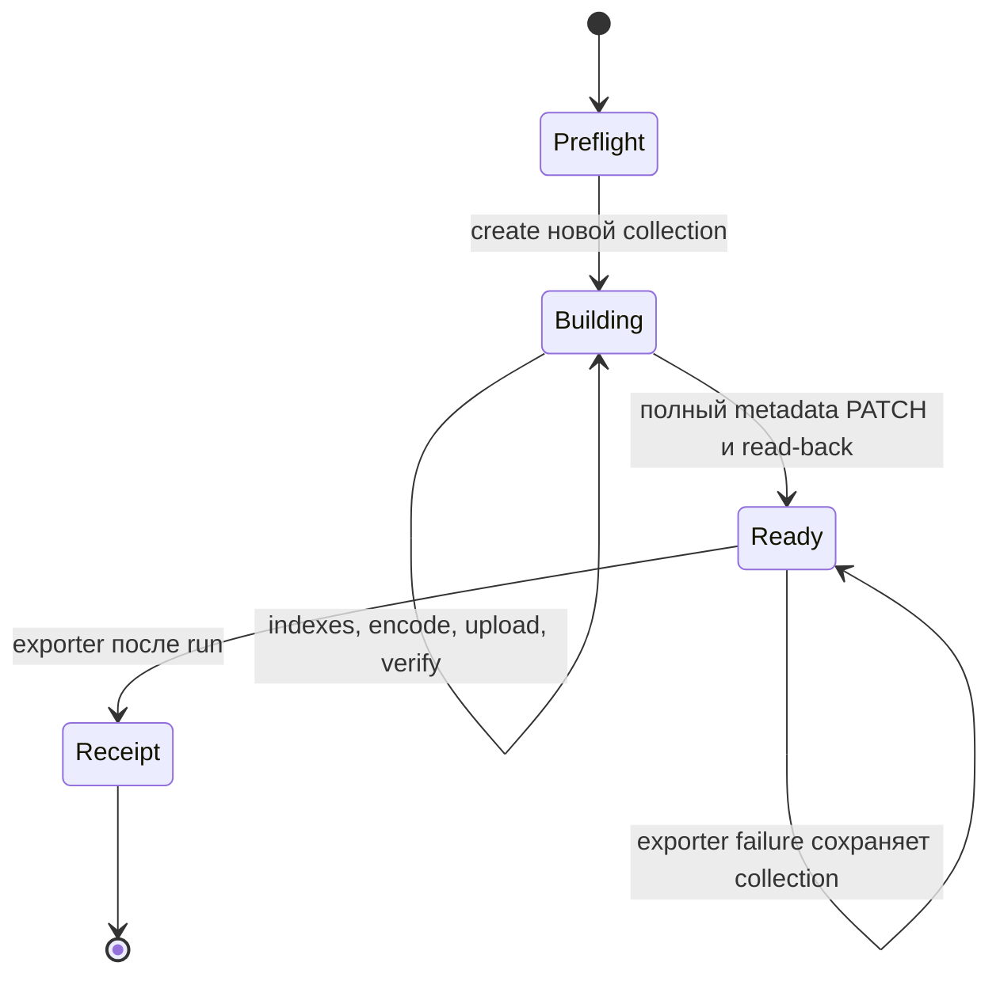

# 008. Векторный поиск вакансий: архитектура, инфраструктура и контракты

Статус: **реализована и проверена локально 2026-10-10: L01–L21 выполнены;
внешняя приёмка G01–G06 не выполнена**. Итоговые проверки и ограничения —
в [development](../development.md), результаты ревью —
в [review](../reviews/2026-10-10-vector-search.md).

Документ фиксирует целевой контракт первой поставки. Разделы 1–8 описывают
сквозную архитектуру; разделы 9–17 уточняют outcome, форматы, конфигурацию,
эксплуатацию, ошибки и acceptance evidence. Реальные результаты локальных gates
и незакрытые границы поставки фиксируются в [development](../development.md).
Это specification, а не task plan по редактированию файлов.

Согласованная граница: только dense vector search, Qdrant запускает пользователь,
корпус изменяемый, целевая машина имеет RAM и NVIDIA GPU. Точная модель GPU, VRAM,
драйвер и ОС пока неизвестны; «NVIDIA T…» не подтверждает T4. Hybrid не входит.

Основа: [архитектура](../architecture.md), [доменный язык](../../CONTEXT.md),
[development](../development.md), [одиночный поиск/batch](005-search-research.md).
Исследование выполнено тремя субагентами GPT-6 Astra:
[inference и инфраструктура](../research/2026-10-10-vector-infrastructure.md),
[encoding запросов и документов](../research/2026-10-10-vector-encoding.md),
[контракт Qdrant](../research/2026-10-10-qdrant-contract.md).

Для чтения: выбранный контур и схемы — разделы 1–4; корпус и публикация — 5–7;
точные форматы и композиция — 9–13; запуск на машине — 14; измерения и критерии
приёмки — 15–17. Раздел 8 отделяет локальные проверки от реального GPU/Qdrant.

## 1. Выбранный контур

| Решение | Контракт первой поставки |
| --- | --- |
| Приложение | Python 3.12+/Poetry на host целевой машины |
| Inference | Один TEI v1.9.4 Docker container на одном выбранном GPU |
| Первая модель | `intfloat/multilingual-e5-base`, revision `d128750597153bb5987e10b1c3493a34e5a4502a` |
| Encoding | 768 dimensions, masked mean pooling, L2, FP16; query/passage prefixes |
| Длина | 512 model tokens вместе с prefix и special tokens |
| Хранилище | Внешний для приложения Qdrant; reference release v1.19.2 |
| Вектор коллекции | Один unnamed dense vector, float32 storage, Cosine; без quantization |
| Единица индексирования | Одна вакансия — один vector и полные исходные fields |
| Pipeline | VectorSearchTransformer → существующий TopK |
| Поставка на машину | Checkout репозитория, Poetry environment, Hydra site overrides, запуск TEI, подготовка коллекции, поиск |

E5-base выбрана как небольшой multilingual baseline с простым проверенным encoding
contract. Это не доказательство лучшего качества на вакансиях. BGE-M3 dense и Qwen3
имеют другой encoding contract; результаты сравнения и trade-offs находятся в
research note. Они не запускаются как автоматический fallback.

Управление процессом Qdrant, его storage и server configuration остаётся у
пользователя. Приложение выполняет разрешённые операции создания и заполнения
собственных исследовательских коллекций. Deployment приложения не стартует и не
перенастраивает Qdrant.

## 2. Инфраструктурная схема



Приложение работает на host, поэтому опубликованный loopback endpoint TEI доступен
как `http://127.0.0.1:8080`. Qdrant URL конфигурируется отдельно; `127.0.0.1:6333`
пригоден только если пользователь действительно опубликовал там REST endpoint.
Docker DNS/network между контейнерами для приложения не требуется.

### GPU и runtime

Сначала на целевой машине выполнить `nvidia-smi -L` и запросить модель, UUID,
VRAM и driver. TEI image выбирается по compute capability, а не по наличию NVIDIA:

| Пример GPU | Compute capability | Проверенный tag TEI 1.9.4 |
| --- | ---: | --- |
| T4 | 7.5 | `turing-1.9.4` |
| A100 | 8.0 | `1.9.4` |
| A10 / RTX 30xx | 8.6 | `86-1.9.4` |
| L4 / RTX 40xx | 8.9 | `89-1.9.4` |
| H100 | 9.0 | `hopper-1.9.4` |

Полный registry image reference имеет вид
`ghcr.io/huggingface/text-embeddings-inference:<tag>@sha256:<verified-digest>`.
Проверенные digests и более новые GPU перечислены в infrastructure note.
CC < 7.5 не поддерживается этим CUDA-путём. Несколько GPU не объединяют VRAM:
первый launcher выбирает один GPU UUID через Docker `--gpus device=GPU-…`.

Для выбранных образов проверен CUDA 12.9.1. Консервативный Linux x86_64 путь —
совместимый NVIDIA driver, ориентир минимум 575.57.08, Docker и NVIDIA Container
Toolkit; точная пригодность подтверждается runtime smoke. Общая фраза «CUDA ≥12.2»
из overview не подтверждает совместимость этого образа с конкретным драйвером.
`/health` не доказывает GPU execution: startup logs и `nvidia-smi` должны показать
использование выбранного GPU. Silent CPU execution не принимается за GPU smoke.

### Один источник deployment configuration

Отдельный Hydra root [configs/vector.yaml](../../configs/vector.yaml) связывает
model/encoding profile, TEI runtime/client, corpus/text recipe, Qdrant source и experiment. Model id и
revision для launcher и client берутся из одного profile через интерполяции.

Узкий executable [launch.py](../../src/integrations/embedding/launch.py)
читает тот же Hydra config, валидирует необходимые значения и запускает TEI через
`subprocess` argv. Он не является новым BaseExperiment или универсальным deploy
framework. В нём нет provisioning Qdrant, shell interpolation или второго набора
model defaults. Docker handles container restart; launcher не реализует supervisor.
Image/GPU UUID/cache path — параметры runtime, а не параметры поискового payload.

Launcher задаёт явно model id, полный revision SHA, float16, mean pooling,
`auto-truncate=false`, capacity limits и persistent cache. Server-side default
prompts отсутствуют: prefix добавляет TextEmbedder. Endpoint bind — loopback.
Параметры сервера и клиента связаны конфигурацией, но max_batch_tokens и HTTP
batch bytes — разные ограничения. Credentials передаются окружением, без inline
значений в CLI overrides или сохранённых Hydra configs.

### Как перенести и запустить

Команды ниже используют реализованные vector config, launcher и wrappers.
Их выполнение на целевой GPU/Qdrant требует prerequisites раздела 14 и отдельной
внешней приёмки. Общий site config из раздела 14.4 используется во всех процессах:
override одного запуска не сохраняется для следующего.

```sh
# На целевой машине: получить checkout и существующий Python toolchain.
git clone git@github.com:nntumakov/recsys-experiments.git
cd recsys-experiments
poetry install
nvidia-smi -L
nvidia-smi --query-gpu=name,uuid,memory.total,driver_version --format=csv

# После подготовки runtime, внешнего Qdrant и общего site config:
poetry run python -m src.integrations.embedding.launch \
  --config-dir /srv/recsys/config --config-name vector-site

poetry run python -m src.run \
  --config-dir /srv/recsys/config --config-name vector-site \
  experiments/vacancy-search/vector@experiment=001-index \
  qdrant.collection=vacancies-e5-g001

poetry run python -m src.run \
  --config-dir /srv/recsys/config --config-name vector-site \
  experiments/vacancy-search/vector@experiment=002-interactive \
  qdrant.collection=vacancies-e5-g001
```

Site overrides должны сохраняться в выбранном site config или в воспроизводимом
наборе overrides; повторные index/search вызовы используют один профиль. Для batch
используется wrapper `003-batch` существующего BatchSearchExperiment. Адрес TEI, путь к
корпусу и текстовые поля также задаются Hydra. Не требуется новый HTTP frontend
для интерактивного CLI или notebook. Команды не содержат запуска Qdrant.

## 3. Модули и их интерфейсы

| Область | Модуль | Ответственность |
| --- | --- | --- |
| `domain/embedding` | EmbeddingProfile, Embedding | Immutable profile и finite vector с profile identity |
| `components/embedding` | TextEmbedder | Query/document encoding policy, prefixes, limits, normalization |
| `components/embedding/vacancy` | VacancyText | Чистый выбор и сборка текстовых полей по corpus recipe |
| `components/corpus` | Настроенный reader | Преобразование конкретного источника в Vacancy со стабильным id |
| `integrations/embedding` | TEIIntegration | Native HTTP, `/info`, `/embed`, response validation |
| `integrations/qdrant` | QdrantIntegration и внешние point/result representations | Native HTTP operations, payload/score conversion, collection metadata |
| `core/transformers/qdrant` | VectorSearchTransformer | Один полный поисковый шаг с обычным PipelineData |
| `experiments/indexing` | VectorIndexExperiment | Snapshot/validation корпуса, batches, новая generation, publication |
| `components/reporting/artifacts` | VectorIndexArtifact | Receipt сборки: collection, corpus, profile/recipe, count, timings |

TextEmbedder предоставляет `encode_query(text) -> Embedding` и
`encode_documents(texts) -> tuple[Embedding, ...]`. Подготовка model input имеет
одного владельца и доступна pure preview. Integration передаётся конструктору;
сеть, GPU/model lifecycle и corpus loading не растворяются в SearchExperiment.
Дополнительные BaseEncoder/Service/Factory/strategy hierarchies заранее не нужны.

Query normalization принадлежит TextEmbedder. VacancyText применяет ту же чистую
text policy отдельно к каждому полю и затем соединяет их разделителем recipe;
TextEmbedder не схлопывает повторно всё document representation, уничтожая `\n\n`.
Он добавляет document prefix, применяет лимиты и проверяет inference response.

VectorSearchTransformer реализует существующий
`transform(data, *, registry) -> PipelineData`. Query embedding — локальное
типизированное значение вызова. PipelineData не получает embedding в context,
items или filters; исходный QueryFilter не переписывается. Поэтому SearchExperiment,
BatchSearchExperiment, registry и TopK используются с прежними интерфейсами.

Отдельный EncodeQueryTransformer потребовал бы нового intermediate payload
contract. В этой итерации композиция encoder и retrieval выражается зависимостями
поискового модуля, а внешняя композиция остаётся обычным именованным pipeline.

Связи при подготовке корпуса и при поиске:



Diagram показывает владельцев и зависимости; порядок remote side effects задаёт
протокол раздела 13. Reader заменяет источник данных, VacancyText — документное
представление, TextEmbedder — encoding contract. Search и index используют одинаковые
значения profile/recipe; registry не управляет загрузкой модели или индексированием.

## 4. Поисковый запрос: точный путь

1. SearchExperiment создаёт независимый PipelineData со статическим context,
   filters и единственным QueryFilter. Transformer фиксирует Request snapshot.
2. Локально проверяются query, declared filter capabilities и значения
   UserPropertyFilter. Неизвестные поля/типы и missing context — ошибка до HTTP.
3. Semantic preprocessing выполняет NFC, whitespace collapse и trim. Регистр,
   `ё`, отрицания, числа, `C++`, `ЧПУ`, `ТСД`, категории и графики сохраняются.
4. TextEmbedder добавляет один `query: ` prefix; локально проверяются UTF-8 bytes
   model input и размер полного JSON body `/embed`, включая escaping и flags.
   Обе проверки выполняются в prepare до обращения к Qdrant или TEI.
   Точный token budget проверяет TEI tokenizer, с `truncate=false`.
5. Перед каждым поиском GET версии сервера, затем GET коллекции проверяют support
   pin, ready metadata, physical name,
   vector schema и embedding profile; `/info` проверяет inference runtime перед
   encode. Кэширования этих проверок и нового session lifecycle пока нет.
   Настроенный endpoint работает с неизменной моделью по операционному контракту.
6. TEI возвращает один нормализованный vector. Проверяются число vectors,
   размерность 768, конечность значений, ненулевой norm и L2 tolerance.
7. Qdrant получает query vector, явные filters и candidate limit. Только после
   полного успешного ответа выполняется conversion points → Vacancy/SERP.
8. Transformer заменяет items; TopK сохраняет первые final_k, SearchExperiment
   возвращает deep snapshot. CLI/batch/export используют существующие контракты.

Пример model input:

```text
Ввод:        «  Комплектовщик   ТСД  2/2 без опыта »
Model input: «query: Комплектовщик ТСД 2/2 без опыта»
```

Нынешний NormalizeText выполняет NFKC+casefold для lexical recognition. Его
поведение сохраняется; semantic policy имеет собственного владельца.
В первом vector baseline нет concatenated aliases, stemming, transliteration,
spelling repair или подмены запроса slot parser результатом. Отрицание остаётся
в model input, но similarity не обеспечивает Boolean exclusion. Строгие требования
задаются явными filters, а устойчивость к опечаткам/negative queries измеряется.

Native `POST /embed` body:

```json
{
  "inputs": ["query: Комплектовщик ТСД 2/2 без опыта"],
  "normalize": true,
  "truncate": false,
  "truncation_direction": "right"
}
```

### Preview

`VectorSearchTransformer.prepare(data)` локально показывает model input,
profile identity, filters и candidate limit. Он не вызывает HTTP.
Полный Qdrant body требует реального query vector: embedding preview выполняет
явный inference вызов. Не наследуется обещание offline `build_query` для полного
body и не вводится скрытый двойной encode на пути preview → search.



При отказе любого шага последующие шаги не выполняются; до successful conversion
items остаётся прежним. Read-only admission не превращает два remote endpoints
в транзакцию: отсутствие смены model и изменения ready collection во время вызова
обеспечивается операционным контрактом.

## 5. Документы и подготовка коллекции

Источник корпуса выбирается Hydra `_target_` и параметрами reader. Первый reader
использует существующую форму JSON списка `{id, fields}`; это конкретный
формат, без угадывания OpenSearch hits или CSV. Смена input path заменяет данные,
смена reader позволяет явно подключить другой источник.

VacancyText выбирает объявленные строковые поля по порядку. Первый preset —
`title`, затем `description`, разделённые `\n\n`. Поля required/optional задаются
recipe; missing/null/blank optional пропускаются, present non-string отвергается.
Вакансия без непустого представления не индексируется молча: сборка завершается
ошибкой до создания коллекции. Исходные fields сохраняются полностью.

После NFC/whitespace подготовки полей model input:

```text
passage: Комплектовщик

Сборка заказов с ТСД. График 2/2. Обучение на месте.
```

Document requests задают `truncate=true`, `truncation_direction=right`. До 512
model tokens сохраняется начало title и доступная часть description. Это не
обещает дополнительный title boost или полное сохранение длинного title. Recipe
фиксирует truncation; доля затронутых документов проверяется через отдельный
corpus audit `/tokenize` на целевой машине. `/tokenize` также HTTP, не offline.

HTML не чистится неявно. Для HTML корпуса требуется plain-text source field либо
конкретный версионированный renderer. Chunking и несколько vectors на вакансию
не входят в начальный профиль.

До remote writes создаётся стабильный локальный snapshot и полностью проверяются
ids, JSON values, текстовое представление, declared scalar filter fields и byte
limits. Digest корпуса строится по canonical records со стабильным порядком;
присутствующие исходные поля входят в provenance. Первый JSON reader имеет
стоимость памяти O(корпус); streaming/resume не обещаются. Embeddings и uploads
обрабатываются bounded batches, а не накапливаются для всего корпуса.

JSON boundary учитывает представление pinned Qdrant: допустимы valid Unicode,
конечные float64 и integers от −2^63 до 2^64−1; bool остаётся отдельным типом.
Нестандартные Python values, NaN/Infinity, lone surrogates и числа вне границ
отклоняются до writes. Integer filter имеет более узкую signed-64 границу;
для поля типа float переход из integer должен быть точным в float64. Никакой
скрытой coercion или потери исходного числового значения не допускается.

Начальные, ещё не измеренные budgets: query до 4096 UTF-8 bytes; один prepared
model document input до 65536 bytes; inference batch до 8 inputs и 262144 bytes
полного JSON body; TEI max_batch_tokens=4096, max_client_batch_size=8; один batch
in flight. Один слишком большой input — ошибка, batch делится детерминированно.
Query/document byte budgets не заменяют tokenizer limit. Значения уточняются
по замерам VRAM/throughput на фактическом GPU.

## 6. Qdrant: payload, filters и публикация

Reference API — Qdrant v1.19.2; выбранный сервер проверяется перед выполнением.
Query Points API существует с 1.10, collection metadata документирована с 1.16,
но это не обещание поддержки всех промежуточных версий. Приложение не требует
новых memory-tier options и не меняет server-wide storage defaults.

Collection vector schema:

```json
{"vectors": {"size": 768, "distance": "Cosine"}}
```

Каждый point хранит vector отдельно от payload:

```json
{
  "document_id": "w002",
  "fields": {
    "title": "Комплектовщик",
    "description": "Сборка заказов с ТСД",
    "city": "Москва",
    "active": true
  }
}
```

Point UUID детерминированно выводится через вложенный UUIDv5 namespace:
фиксированный project namespace → exact corpus identity → exact domain id.
Алгоритм version фиксируется в recipe. Domain ids и point ids уникальны до writes;
в результат возвращается `document_id`, исходные `fields` и native score.

Native query example для `POST /collections/<collection>/points/query`:

```json
{
  "query": [0.01, 0.02],
  "filter": {
    "must": [
      {"key": "fields.city", "match": {"value": "Москва"}},
      {"key": "fields.active", "match": {"value": true}}
    ]
  },
  "limit": 100,
  "with_payload": true,
  "with_vector": false
}
```

Два числа здесь только сокращённая иллюстрация; реальный body содержит **768**
значений. Candidate depth >= final_k, initial candidate_depth=100/final_k=20.
Cosine score и порядок берутся от Qdrant; клиент не пересортировывает hits и не
интерпретирует score как probability или judgment.

Обычный retrieval использует `exact=false`, `indexed_only=false` и настраиваемый
`hnsw_ef`; quality baseline выполняется с `exact=true` по тем же query vectors.
`indexed_only=true` нельзя скрыто включать ради latency: он способен исключить
ещё неиндексированные segments. На маленьком корпусе даже `exact=false` может
исполняться без HNSW; это не performance evidence полноценного ANN.

Filter capability явно связывает domain field с Qdrant payload path и типом.
Keyword, bool и signed-64 integer используют `match.value`; finite float equality
выражается range с одинаковыми `gte`/`lte`, с числовой семантикой движка. Null,
неподдержанные типы и невалидные integer bounds отклоняются. Все условия остаются
AND внутри retrieval. Declared payload indexes строятся до загрузки points. Нельзя молча
переносить `.keyword` из OpenSearch или смешивать literal dotted keys с paths;
точный native path объявляется конфигурацией.

### Source of truth готовности

Новая сборка создаёт новую физическую collection с полным owned metadata object:
`schema_version`, `state=building`, physical collection name, corpus identity/digest,
embedding profile/id, text recipe/id, runtime provenance и expected count. Это metadata коллекции,
не дополнительный point, способный попасть в выдачу.

Порядок завершения в standalone контуре с одним writer:

1. Полный локальный preflight; read-only проверка runtime/profile/Qdrant и реальный
   embedding probe до создания collection.
2. Создать fresh collection; существующее имя — ошибка без overwrite/delete.
3. Создать declared payload indexes с `wait=true` до points: filter-aware HNSW
   должен знать типы полей при индексировании. Проверить `completed`.
4. Записать валидные batches через upsert `wait=true`; проверить `completed`.
5. Проверить vector schema, exact point count и metadata/profile. Для первой
   исследовательской сборки выполнить полный bounded read-back ожидаемых ids:
   id/payload соответствуют snapshot, vector существует, имеет нужную dimension
   и конечные values. Это дополнительные O(N·D + payload) чтения/передачи;
   bitwise равенство float32/Cosine storage с inference JSON не требуется.
6. Bounded ожидание `status=green`, `optimizer_status=ok` и declared indexes;
   exact filtered smoke. Timeout оставляет сборку незавершённой. Маленький корпус
   может иметь `indexed_vectors_count=0`; равенство счётчика N не требуется.
7. PATCH **полного** owned metadata object в `state=ready`, затем GET read-back.
8. Вернуть VectorIndexArtifact; существующий exporter сохраняет receipt.

`points_count`/`indexed_vectors_count` приблизительны; verification использует
`POST points/count` с `exact=true`. PATCH metadata не имеет `wait` и возвращает
`result=true`, не UpdateResult. Nested metadata merge shallow: нельзя отправить
только `{recsys:{state:ready}}` и потерять profile. Детали проверены в research note.

Remote ready metadata — source of truth для поиска. Local artifact — receipt,
не второй gate. Если exporter упал после ready, коллекция остаётся полностью
собранной и searchable, CLI сообщает ошибку записи receipt. Автоматического
rollback/delete и общей транзакции Qdrant+filesystem нет.

Metadata содержит полный контракт, а не только hashes. Search требует совпадения
physical name из metadata с настроенным именем: alias не может незаметно заменить
конкретную generation. Completed upserts + exact count сами по себе не доказывают
полный round-trip payload; ослабление полного read-back до sample требует явного
изменения acceptance evidence, а не заявления о той же проверке.

До ready незавершённая сборка остаётся building; поиск её отклоняет. Timeout write
или ready PATCH оставляет неопределённость remote состояния, а не обещание rollback.
Уборка только адресная и явная. Aliases, inplace updates, automatic retries/resume
не входят. Готовая
collection считается immutable; concurrent writers и незаметная замена endpoint
модели запрещены операционным контрактом первого контура.

`wait=true` означает применённые points, но не завершённый HNSW index. На маленьком
корпусе поисковая готовность возможна без полного ANN; latency/ANN readiness
фиксируются отдельно. Exact dense quality и ANN recall относительно exact
retrieval проверяются раздельно.

## 7. Identity, ошибки и диагностика

Embedding profile фиксирует model/tokenizer SHA, dimension, pooling, prefixes,
normalization, semantic text policies, query overflow/document truncation и dtype.
Text recipe и corpus digest фиксируются отдельно. Смена модели, представления
документа или несовместимого encoding contract требует новой collection.

TEI `/info.model_sha` — переданный revision argument, не вычисленный hash weights.
Запуск с полным SHA, pinned image/dtype/pooling, проверка `/info` и encoding probe
подтверждают управляемый runtime contract; это не криптографическая аттестация.
`/info` не содержит dimension/default prompt: dimension проверяется probe и каждым
ответом, отсутствие default prompts обеспечивается launcher recipe. Версия backend
и image digest сохраняются в provenance; E5/TEI не обещает битовое равенство с
Transformers runtime, особенно FP16 и approximate GeLU.

Malformed inference matrix, zero/nonfinite vectors, wrong dimension/profile,
invalid point payload, duplicate domain id или nonfinite score — ошибка до нового
items/upload batch. Повреждённый последний hit отвергает весь search result.
Ошибка не становится пустой SERP или fallback. Готовые предыдущие collection и
артефакты не перезаписываются. Ручной поиск после ошибки можно повторить.

На первом этапе сохраняются существующие search JSON/CSV. Build receipt содержит
полный profile/recipe/runtime provenance. Notebook может явно исследовать prepared
text, real vector и actual request/response; технические поля не добавляются к
Vacancy.fields. Расширение persistent search evidence format в первый этап не
включается автоматически.

## 8. Verification и граница поставки

### Локальная реализация

- Contract tests pure text recipe/preprocessing и profile identity.
- Настоящие Hydra и локальные HTTP servers: TEI → Qdrant → SERP → SearchExperiment
  → batch → JSON/CSV, включая actual bodies, AND filters и полный payload.
- Невалидный полный корпус до writes, profile mismatch, inference/upload failure,
  building collections, exact count verification, ready read-back, exporter failure.
- No downstream call/partial items, запрет overwrite, повторный ручной search.
- Launcher argv и config interpolation без GPU, без вывода credentials.
- Canonical Ruff/format/ty/pytest и regressions действующих experiments.

### Целевая машина

1. Проверить GPU/driver/runtime и pinned model; warmup реального embedding.
2. Построить небольшой corpus generation в пользовательском Qdrant.
3. Проверить query/document prefixes, token limits, filter semantics, ids/fields,
   повторный поиск и persistence после restart.
4. Измерить token lengths/truncation, VRAM, ingestion throughput, p50/p95 latency.
5. Проверить model quality по judgments и ANN recall против exact по тем же vectors.

HTTP fixtures не подтверждают GPU compatibility, actual tokens, semantic quality,
ANN recall или runtime latency. Текущий VPS не используется для image pulls,
model downloads или live deployment. Реальные результаты записываются в development
после исполнения, а не выводятся из источников или local tests.

Открыты только site-specific inputs и экспериментальные evidence: точная GPU/ОС,
драйвер/image choice, доступный Qdrant release/URL, corpus reader/fields/HTML и
quality/throughput. Архитектура не требует заранее раскрывать credentials или
добавлять ML dependencies в основное Poetry environment.

Принятые термины и владельцы отражены в CONTEXT/architecture; operational commands
находятся в README, actual evidence — в development. Ограничение владения remote
index state относится к OpenSearch-proxy пути. Приложение владеет построением
собственных Qdrant generations, оператор — процессом и storage Qdrant.

## 9. Outcome, границы и совместимость

### 9.1. Наблюдаемый результат

Исследователь получает воспроизводимый путь от настроенного корпуса до interactive
и batch vector search. Один source snapshot, document recipe и embedding profile
определяют содержимое новой Qdrant collection. Тот же embedding profile кодирует
запросы; поиск возвращает исходные domain ids и полные fields в обычной SERP.

Первая поставка позволяет выбрать корпус/поля, запустить общий TEI endpoint,
построить и проверить коллекцию, затем использовать текущие одиночный, interactive,
batch и notebook сценарии. Semantic relevance, ANN recall и performance оцениваются
раздельно. Local contracts можно реализовать до появления целевой GPU; live
compatibility и численные результаты требуют отдельного запуска на ней.

### 9.2. Входит и не входит

Входит один E5-base profile, один TEI endpoint/выбранная GPU, JSON reader с изменяемым
path/identity/field recipe, standalone Qdrant 1.19.2, scalar equality filters,
новые immutable generations, полный verify/ready/receipt, Hydra launcher и wrappers.
Будущий reader подставляется concrete implementation; готовые API/CSV/OpenSearch
readers первой поставкой не обещаются.

Не входят hybrid/BM25/RRF, sparse/multivector retrieval, reranking, chunking, LLM
rewrite, извлечение обязательных filters из текста, streaming/resume, incremental
updates/deletes, automatic retries, aliases, quantization, multi-GPU scheduler,
replicated Qdrant, HTTP frontend и универсальный deployment framework. Подстановка
другого model_id сама по себе не означает поддержку новой модели/encoding policy.

### 9.3. Compatibility

Текущий `main.yaml` и experiment defaults не переключаются. Сохраняются интерфейсы
BaseTransformer, BaseRegistry, BaseIntegration, PipelineData, SearchExperiment.search
и прежние JSON/CSV. BaseIntegration остаётся marker: indexing methods не добавляются
всем integrations. Backend reserve и OpenSearch adapter не становятся владельцами
Qdrant/TEI. Не создаются registry embeddings или второй исполнитель graph.

VectorIndexExperiment использует BaseExperiment.run/_wrapped_run: remote writes
и publication принадлежат run, локальный receipt — существующему exporter. Indexing
не изображается пользовательским pipeline с фиктивными filters. Technical metadata
и vectors не добавляются в Vacancy.fields или context пользователя.

## 10. Data contracts и воспроизводимая identity

### 10.1. EmbeddingProfile и Embedding

EmbeddingProfile — immutable typed value с persisted representation:

| Поле | Значение первого профиля |
| --- | --- |
| schema_version | 1 |
| model_id/revision | E5-base и полный HF SHA раздела 1 |
| tokenizer_model_id/tokenizer_revision | Тот же pinned repository/revision |
| dimensions/pooling/normalization | 768 / masked mean / L2 |
| query_prefix/document_prefix | `query: ` / `passage: ` |
| query_text_policy | `nfc-whitespace-v1` |
| document_text_policy | `fieldwise-nfc-whitespace-v1` |
| max_tokens | 512, вместе с prefix/special tokens |
| query_overflow/document_overflow | reject / truncate_right |
| inference_dtype/model_quantization | float16 / none |

Embedding содержит profile_id и immutable tuple values. Полный inference batch
проверяется на внешней границе: число rows, dimension, numeric без bool, finite,
представимость float32, ненулевой norm и `abs(norm - 1) <= 1e-3` для L2 output.
Неправильный batch отвергается целиком; silent renormalization не исправляет его.
Допуск — engineering contract, не результат GPU benchmark.

Integration владеет HTTP shape; TextEmbedder — semantic profile/dimension/norm.
Доменный тип не зависит от HTTP/TEI/Qdrant. Уже проверенный Embedding не требует
повторения всех внешних проверок в каждом internal caller.

### 10.2. Reader и snapshot

Первый reader читает UTF-8 JSON array. Element — object с ровно `id` и `fields`;
legacy score и дополнительные envelope keys не импортируются молча. ID — nonblank
string; fields — JSON object. Duplicate JSON keys, invalid Unicode, числа вне
boundary раздела 5 и пустой корпус отклоняются. Duplicate ids запрещены даже
при равных fields. Reader возвращает Vacancy без поискового score.

ID сохраняется точно: `" a "` не превращается в `"a"`, регистр и Unicode не
нормализуются. Index experiment фиксирует independent snapshot одного чтения;
изменение файла после этого не меняет generation. Reader interface возвращает
конечный snapshot вакансий; дополнительные base classes без второй реализации
не нужны. Первый JSON reader имеет стоимость O(N + total fields bytes) памяти.

Document recipe v1 хранит ordered `{name, required}`, separator, renderer identity
и policy. Default title/description — оба optional; общий пустой текст запрещён.
Required missing/null/blank — ошибка; optional missing/null/blank пропускается;
present non-string всегда ошибка. Names — literal top-level original keys, а не
filter paths. Каждый field проходит NFC/whitespace/trim, затем непустые значения
соединяются separator. Prefix добавляется после соединения ровно один раз.

Полные fields могут содержать nested objects/arrays/literal dotted keys: они
сохраняются даже когда недоступны для text/filter recipe. Lossless contract
относится к JSON values/числовым типам, а не форматированию исходного файла.

### 10.3. Canonical serialization

Для profile/recipe/source contract serialization_version=1 означает sorted object
keys, `ensure_ascii=false`, `allow_nan=false`, separators `(',', ':')`, UTF-8 без
BOM. Array order сохраняется. Unicode values здесь не нормализуются: model text
policy имеет отдельного владельца. Digest — SHA-256 этих bytes, lowercase hex.

Corpus digest вычисляется по validated original records, упорядоченным по UTF-8
bytes exact id: header bytes `recsys-corpus-v1\n`, затем canonical `{id, fields}`
каждой record и `\n`. Hash вычисляется последовательно после сортировки snapshot;
giant JSON array второй раз создавать не требуется. Path не идентифицирует corpus.

Persisted profile не содержит Hydra `_target_`, credentials, URL, timeout, image
или batch limits. Recipe/source сериализуются явными полями, без object dump или
resolved Hydra config. Renderer/reader identity версионируется.

### 10.4. Point ID algorithm v1

Фиксированная namespace recipe:

```python
project_namespace = uuid5(NAMESPACE_URL, "urn:recsys-experiments:vacancy:v1")
corpus_namespace = uuid5(project_namespace, corpus_identity)
point_id = uuid5(corpus_namespace, exact_document_id)
```

Corpus identity — explicitly configured nonblank string, сохраняемый без strip;
это логическое имя, не filename и не digest. Пересборка того же corpus сохраняет
point id вакансии; независимо выбранный corpus получает другую identity. До writes
проверяются uniqueness domain ids и uniqueness всех UUID. Metadata сохраняет
algorithm/version/namespace recipe. Adapter пересчитывает UUID из response id.
UUIDv5 не считается криптографической гарантией отсутствия коллизий.

### 10.5. Изменения и пересборка

| Изменение | Требуемое действие |
| --- | --- |
| Модель/tokenizer SHA, pooling, prefixes, dimension, normalization, dtype/quantization, text policy | Новый profile и collection |
| Corpus contents/identity, renderer/fields/order/required, filter declarations, payload/ID schema | Новая generation |
| TEI version/image digest | Новая сборка первого контура; эквивалентность старых vectors не предполагается |
| Candidate depth/final_k, exact/ANN query parameters | Поиск той же ready collection |
| Batch capacity, timeout, перенос того же pinned runtime/collection на другой URL | Не меняют embedding space; destination identity проверяется, runtime evidence фиксируется |

Search сравнивает полный profile и его digest, expected corpus identity/document
recipe/filter declarations и vector/payload/ID schema. Одной dimension недостаточно.

## 11. Hydra configuration и composition contract

### 11.1. Groups и defaults

Vector root и launcher используют один конфиг. Supporting groups вложены в
`configs/vector/embedding`, `corpus`, `qdrant`; wrappers — в
`configs/experiments/vacancy-search/vector`. Целевые defaults:

```yaml
defaults:
  - vector/embedding@embedding: multilingual-e5-base
  - vector/corpus@corpus: json-vacancies
  - vector/qdrant@qdrant: standalone
  - experiments/vacancy-search/vector@experiment: 002-interactive
  - _self_
```

Hydra output policy сохраняет unique run directories и job.chdir=false. Launcher
не instantiate experiment/registry/corpus. Missing corpus path допустим для него
и search готовой коллекции, но index обязан потребовать path до writes.

### 11.2. Materialized shape

Ниже схема параметров после композиции groups; `???` — обязательный site input.
Concrete `_target_` находятся в [groups vector](../../configs/vector) и
[wrappers](../../configs/experiments/vacancy-search/vector) согласно разделу 3.

```yaml
embedding:
  profile:
    schema_version: 1
    model_id: intfloat/multilingual-e5-base
    revision: d128750597153bb5987e10b1c3493a34e5a4502a
    tokenizer_model_id: ${embedding.profile.model_id}
    tokenizer_revision: ${embedding.profile.revision}
    dimensions: 768
    pooling: mean
    normalization: l2
    query_prefix: "query: "
    document_prefix: "passage: "
    query_text_policy: nfc-whitespace-v1
    document_text_policy: fieldwise-nfc-whitespace-v1
    max_tokens: 512
    query_overflow: reject
    document_overflow: truncate_right
    inference_dtype: float16
    model_quantization: none
  client:
    url: http://127.0.0.1:8080
    api_key: ${oc.env:TEI_API_KEY,null}
    timeout: 60.0
  runtime:
    version: 1.9.4
    image: ???
    gpu_uuid: ???
    container_name: recsys-tei
    cache_dir: ???
    host_port: 8080
    startup_deadline: 600.0
    max_batch_tokens: 4096
    max_client_batch_size: 8
    max_concurrent_requests: 32
    auto_truncate: false
  limits:
    query_bytes: 4096
    document_bytes: 65536
    batch_inputs: 8
    batch_bytes: 262144
    response_bytes: 1048576
    tokenize_response_bytes: 16777216

corpus:
  identity: vacancies-research-v1
  path: ???
  reader: json-vacancies-v1
  text:
    schema_version: 1
    renderer: vacancy-fields-v1
    fields:
      - {name: title, required: false}
      - {name: description, required: false}
    separator: "\n\n"

qdrant:
  url: ???
  api_key: ${oc.env:QDRANT_API_KEY,null}
  version: 1.19.2
  collection: ???
  timeout: 120.0
  operation_timeout: 60
  verification_deadline: 600.0
  response_bytes: 33554432
  payload_bytes: 262144
  upload_batch_bytes: 4194304
  filter_fields: {}
  vector: {size: 768, distance: Cosine}
  shards: 1
  replicas: 1
  write_consistency: 1

retrieval:
  candidate_depth: 100
  final_k: 20
  exact: false
  indexed_only: false
  hnsw_ef: 128
```

Actual vector.size связывается с embedding.profile.dimensions через интерполяцию;
768 в shape показывает resolved value. Model/revision/pooling/dtype не дублируются
в Docker defaults. Credentials читаются из environment. Интерполяции не обещают
Python object identity; эквивалентность immutable profile values достаточна.
Материализованный qdrant.vector передаётся QdrantSource и проверяется до HTTP:
только object с dimension профиля и Cosine; null, другие типы и несовместимые
size/distance отвергаются, а не игнорируются.

Payload budget относится к serialized payload object `{document_id, fields}`
одного point, без UUID и vector. Upload budget
считается по полному body с id/vector/payload; response bytes ограничиваются до
JSON parse. Oversized input/payload не обрезается. Эти начальные budgets не являются
production измерениями; подлежат явному изменению после capacity evidence.

### 11.3. Registry и wrappers

Interactive создаёт SearchExperiment с pipeline=search_pipeline и нынешним
BasicTransformerRegistry. Entries:

| Имя | Объект | Зависимости |
| --- | --- | --- |
| search_pipeline | PipelineTransformer | steps=[vector_search, top_k] |
| vector_search | VectorSearchTransformer | TextEmbedder, QdrantIntegration, expected source/profile и retrieval settings |
| top_k | TopKTransformer | k=${retrieval.final_k} |

001-index создаёт VectorIndexExperiment с reader, VacancyText, TextEmbedder,
QdrantIntegration и одним JSONExporter. 003-batch собирает нынешний
BatchSearchExperiment с тем же SearchExperiment. Notebook использует Compose API
и instantiate по spec 005. Изменение config требует новой instantiate.

Search использует expected corpus identity/profile/recipe, но не читает reader/path;
исходный JSON может отсутствовать. Candidate depth/final_k/hnsw_ef — positive ints,
не bool; candidate_depth >= final_k. Score threshold не вводится. При index
проверяются согласованность runtime/client batch limits и token capacity; search
требует capacity для одного query. Missing site input не получает silent default.

## 12. HTTP, filters, results и preview

### 12.1. TEI contract

Используется native `/embed`, а не `/v1/embeddings`. Нужны `/info`, `/health`,
`/embed`, `/tokenize` для corpus audit. `/info` до encode проверяет model_id,
полный model_sha/revision, dtype, mean pooling, TEI version и effective limit 512.
Dimension/norm проверяются probe и каждым response. Prompts выключены launcher;
prompt_name не отправляется. Native response — bare 2D array в порядке inputs.

Audit `/tokenize` выполняется последовательно, один prefixed document на request,
с `add_special_tokens=true` и без truncation. Native response — двумерный array
token objects с id/text/special/offsets. Для него отдельный 16 MiB response budget:
1 MiB embedding limit не применяется, поскольку audit возвращает все tokens даже
длинного passage. Превышение audit budget — явная ошибка без успешного отчёта или
ложного truncation count; budget можно увеличить после оценки памяти. Token list
текущего документа освобождается до следующего. Audit не объявляет обработанным
документ, для которого получен неполный/oversized ответ.

HTTP transport закрывает response, не следует redirects, проверяет size/JSON
и не пересылает credentials другому endpoint. NaN/Infinity запрещены. HTTP/JSON/
capacity/profile failure сохраняет исходную error chain. Standard library
достаточна; generic transport framework/ML SDK не требуются.

### 12.2. Declared scalar filters

Public TermFilter.field связывается с path list относительно original fields:

```yaml
filter_fields:
  city: {path: [location, city], type: keyword}
  active: {path: [active], type: bool}
  grade: {path: [grade], type: integer}
  hourly_rate: {path: [hourly_rate], type: float}
```

Path — nonempty list сегментов `[A-Za-z_][A-Za-z0-9_]*`; native key — `fields.`
и path через точки. Literal dotted keys, quotes/wildcards, array indexes и nested
arrays не входят в filter interface, хотя original payload их сохраняет.
Несколько public names могут ссылаться на один path только с одинаковым типом:
native index тогда создаётся один раз. Разные типы одного path — ошибка конфигурации
до HTTP/create, а не выбор последнего объявления.

Missing/null document property допустим и не удовлетворяет positive condition;
present intermediate non-null non-object или wrong scalar type — preflight error.
Все declared paths получают payload indexes. Keyword/string, bool/bool и signed
int64/int используют match.value. Float принимает finite float или точно
представимый float64 int, без bool, и использует range.gte=range.lte. Нет epsilon,
округления денег или преобразования `7.0` в int. Null term, missing context,
unknown field/тип BaseFilter — error до HTTP. Все условия AND; без условий filter
опускается. Валидные противоречивые условия могут вернуть пустую SERP.

### 12.3. Qdrant operations

Первый support pin — server 1.19.2. GET `/` проверяет version до writes и admission
search. Required operations и acknowledgments:

| Operation | REST | Successful evidence |
| --- | --- | --- |
| Create | PUT /collections/{name} | status=ok, result=true |
| Descriptor | GET /collections/{name} | result.config.metadata.recsys, schema/health/indexes |
| Payload index | PUT /collections/{name}/index?wait=true&timeout=N | result.status=completed |
| Upsert | PUT /collections/{name}/points?wait=true&timeout=N | result.status=completed |
| Retrieve | POST /collections/{name}/points | expected ids, with_payload=true, with_vector=true |
| Count | POST /collections/{name}/points/count | body exact=true; result.count=N |
| Query | POST /collections/{name}/points/query | status=ok, result.points |
| Ready | PATCH /collections/{name}?timeout=N | result=true и GET read-back |

Новые names ограничены `[A-Za-z0-9][A-Za-z0-9_-]{0,127}` — application contract,
а не полный Qdrant naming API; path segment всё равно URL-encoded. До side effects
проверяются URL/header/timeout/name/config. Auth: Qdrant api-key из QDRANT_API_KEY;
TEI Bearer из TEI_API_KEY. Nullable auth допустима только для допускающего её endpoint.

Operation timeout 60 s передаётся только в поддерживающие его pinned endpoints.
HTTP socket timeout 120 s превышает его с запасом; config требует минимум 10 s
запаса между transport и server operation timeout. Это уменьшает преждевременный
client timeout, но не гарантирует отсутствие ambiguous write при network failure.
Readiness polls ограничивают каждый transport call оставшимся deadline, чтобы
последний request не получал полный timeout сверх budget ожидания.
Во время чтения response body истечение deadline прерывает socket, включая
чтение chunk framing; HTTP success после deadline не принимается за готовность.
DNS resolution и разбор HTTP headers сохраняют ограничения стандартного urllib/socket:
deadline не является жёсткой отменой всех OS/network операций.

Create задаёт unnamed Cosine vector, одну shard/replica/write consistency и metadata
building. Actual HNSW/optimizer/storage settings читаются и входят в receipt.
Query params содержат exact/indexed_only/hnsw_ef; using/prefetch/fusion/inference
objects не отправляются. Upsert — id UUID, vector array и payload envelope раздела 6.

### 12.4. Atomic result conversion

Каждый hit требует UUID id, nonnegative int version, finite numeric score без bool,
nonblank original document_id, JSON-object fields и корректный UUID mapping.
Duplicate native/domain ids запрещены. Весь result.points конвертируется до
присвоения data.items; malformed последний hit не публикует предыдущие.

Fields получают independent snapshot. Порядок источника сохраняется; tie order
ANN между вызовами не обещается. При with_vector=false отсутствие vector нормально.
Technical fields не попадают в Vacancy.fields. Успешные points=[] отличаются от
HTTP failure; request error не становится пустой успешной SERP.

### 12.5. Pure prepare и явное исследование embedding

Prepare возвращает immutable plan: original query, model input, expected profile/
source, scalar conditions, candidate depth и retrieval params. Zero HTTP/mutation;
plan не подтверждает remote readiness и не содержит фиктивный vector.

Transform использует те же preparation rules и один `/embed` на query. Notebook
может явно вызвать encode_query(original_text); последующий независимый search
выполнит собственный encode. Эти два явных действия не создают hidden cache или
search-with-cached-vector mode. Prepared prefixed string не подаётся как raw query.
Actual Qdrant body исследуется только с настоящим явно полученным vector.

## 13. Collection lifecycle, publication и recovery

### 13.1. Remote descriptor v1

`result.config.metadata.recsys` — полный owned application object:

| Поле | Смысл |
| --- | --- |
| schema_version/serialization_version | Оба 1 |
| generation_id/physical_collection_name | Оба равны выбранному уникальному physical name первого контура |
| state | building либо ready |
| expected_points | Число validated records, positive int |
| corpus_identity/corpus_sha256 | Логический corpus и digest snapshot |
| embedding_profile/embedding_profile_sha256 | Полный profile и digest |
| document_recipe/recipe_sha256 | Fields/order/required/separator/renderer и digest |
| source_profile/source_profile_sha256 | Filter declarations, vector/payload/ID contract и digest |
| id_schema/payload_schema_version | Namespace algorithm v1 / envelope v1 |
| runtime | TEI version/image digest, checked model/dtype/pooling/input limit, Qdrant version |
| verification | Для ready: protocol, exact count, read-back count, health/indexes и smoke evidence |

Source profile содержит embedding profile ID, corpus identity, recipe ID,
filter declarations и vector/payload/ID schema. URL/credentials, retrieval params
и absolute source path в него не входят. State не входит в immutable fingerprints.
Полные corpus records в descriptor не копируются. Ready verification protocol —
`full-readback-v1`; sample не выдаётся за full.

Обязательная форма `verification` после успешных проверок (числа в примере
иллюстрируют корпус из двух документов):

```json
{
  "protocol": "full-readback-v1",
  "exact_count": 2,
  "read_back_count": 2,
  "status": "green",
  "optimizer_status": "ok",
  "indexes": {"fields.active": "bool"},
  "smoke": true
}
```

Оба count равны expected_points и имеют тип int, не bool. Indexes содержит ровно
ожидаемые native paths/types; при отсутствии declarations это `{}`. `smoke=true`
фиксирует успешный протокол следующего раздела, а не только HTTP 200. Дополнительные
измерения допустимы, но не заменяют обязательные поля и не меняют их смысл.

Create сразу сохраняет immutable contracts; при ready меняются state и verification.
PATCH отправляет полный recsys object, сохраняя прочие top-level metadata namespaces.
Search recomputes hashes и сравнивает полные contracts с expected configuration.
Unknown schema, disagreeing hashes и alias вместо physical name отклоняются до encode.

Отдельно сравниваются expected TEI version/image digest общего site runtime config
с descriptor.runtime до encode; image mismatch требует новой generation согласно
разделу 10.5. Search не читает GPU/cache settings, но должен получить эти runtime
pins. Actual running image проверяет launcher/оператор в управляемом deployment:
`/info` подтверждает version/model contract, а image digest не аттестует.

Readiness — протокол приложения, не enforced immutability Qdrant. Нужны один writer
и отсутствие out-of-band mutation ready generation. GET descriptor не доказывает
неизменность каждого payload при нарушении этого контракта. Read-only credentials
используются для search, если доступны у владельца; приложение не provisioning ACL.

### 13.2. State machine и verification



Preflight проверяет config, весь corpus, ids/UUID/JSON/filter/text/byte budgets,
receipt destination и read-only runtime/profile/probes до create. Предварительная
проверка receipt path не исключает будущий filesystem failure. Existing collection
не adopt даже когда пустая/building. Exists check не устраняет race: create должен
действительно создать новую collection. Payload indexes предшествуют points.

Inference response проверяется целиком до upsert данного batch. Ранее завершённые
batches не откатываются при сбое следующего. Exact count должен равняться N;
полный read-back expected ids идёт bounded batches с payload/vector. Проверяются
ids, uniqueness, исходные JSON values/типы, vector dimension/finite/nonzero norm.
Bool отличается от numeric, object key order не важен. Bitwise равенство float32/
Cosine storage с inference JSON не требуется. Дополнительный network cost явно O(ND).

Health wait выполняет GET polls каждые 5 s с verification_deadline. Это readiness
polling, не retry write. Требуются green/optimizer ok/declared indexes и exact
filtered smoke. Indexed_vectors_count=N не требуется: маленькие segments могут
обслуживаться exact scan. ANN acceptance проверяется отдельно на достаточном corpus.

Smoke использует реальный vector одного проверенного документа, `exact=true`,
`indexed_only=false`, limit=1 и обычную полную конвертацию ответа. Его вариант
выбирается детерминированно по порядку public field names и UTF-8 bytes ids:

- Нет declared filter fields: query без filter обязан вернуть непустую SERP.
- Есть хотя бы одно non-null значение: выбрать первое поле и первый документ
  с таким значением, передать его typed equality condition. Выдача непустая;
  каждый возвращённый документ удовлетворяет этому условию по snapshot.
- Все declared values missing/null: для первого поля построить валидное условие
  соответствующего типа (`"recsys-smoke-v1"`, true, 0 или 0.0). Выдача пустая,
  поскольку весь validated snapshot не содержит значения этого поля.

Smoke не требует конкретного top-1 id при равных vectors и не оценивает relevance.
Проверка непустоты/пустоты и условие выполняются до ready PATCH; нарушение оставляет
generation незавершённой. Полноценные AND/type cases проверяются отдельно по L08/G03.

После ready PATCH выполняется GET и сравнивается полный descriptor/state.
Run возвращает artifact только после этого. Приложение больше не пишет points,
profile или schema этой generation. Ready collection выбирается exact physical
name; default/alias не переключается автоматически.

### 13.3. Failure matrix

| Failure boundary | Известное состояние | Поведение |
| --- | --- | --- |
| Local preflight/profile/probe | Новая collection не создана | Ошибка до writes; исправить вход |
| Create conflict/race | Name занят | Выбрать новый name, не менять existing |
| Encode batch | Batch не отправлен; прежние могли примениться | Stop, без ready/receipt |
| Upsert timeout | Write мог примениться | Stop, не обещать rollback |
| Count/read-back/health mismatch | Сборка не проверена | Без ready, новая generation после исправления |
| Ready PATCH/read-back timeout | Ready мог примениться | CLI failure; адресная проверка оператором |
| Receipt exporter failure | Remote ready подтверждён | Search доступен; CLI error относится к receipt |
| Search HTTP/malformed hit | Новая успешная SERP отсутствует | Payload прежний, без partial publication |

Automatic retries/resume/delete/failed PATCH не выполняются. Второй write в catch
не должен маскировать исходную ошибку. Recovery indexing — новое уникальное имя
и новая сборка snapshot. Адресная уборка abandoned generation возможна оператором
после проверки ownership/use, но не launcher/search. Ready collections не удаляются.

Ручной search после ошибки допустим; CLI interactive при ошибке завершает сессию
по прежнему контракту. Batch останавливается без экспортируемого partial artifact.
После ambiguous write downstream publication не запускается. Missing receipt не
блокирует поиск; отдельный CLI export-receipt mode в первую поставку не входит.

### 13.4. VectorIndexArtifact schema v1

Receipt содержит schema_version=1, artifact_type=vector_index, полный descriptor,
non-secret reader/source description, expected/verified counts, actual vector/
payload/HNSW/optimizer settings, runtime provenance и phase timings. Records,
все vectors, credentials и resolved Hydra config в него не копируются.

Artifact — independent snapshot, to_dict не делает I/O. Один existing JSONExporter
атомарно публикует vector-index.json в unique run directory без overwrite.
Filesystem и Qdrant не имеют общей транзакции. Local receipt — evidence, не search gate.

## 14. Операционный runbook целевой машины

### 14.1. Prerequisites и provisioning

Первый подтверждаемый deployment — Linux x86_64, Python 3.12+, Poetry 2.2+,
Docker Engine 28+ для loopback-only publishing, NVIDIA driver/Container Toolkit,
совместимая GPU и самостоятельно поднятый Qdrant 1.19.2. Другой OS/architecture
требует явной проверки; upstream ARM image не означает принятую поддержку.

Оператор обеспечивает driver/toolkit, Qdrant persistence/backup/permissions и
доступ registry/HF либо pinned cache. Launcher не устанавливает packages, не
настраивает NVIDIA runtime и не перезапускает Docker. Toolkit provisioning может
затронуть Qdrant при restart Docker: это предварительное действие владельца.

Перед install/pull/download проверяются df -h / и целевые Docker/cache filesystems;
оцениваются expanded layers, веса, corpus, index и coexistence generations.
Для E5-base проверены ~1.11 GB weight file/~17 MB tokenizer; Turing image имеет
~3.06 GB compressed layers, expanded size больше. Это не VRAM requirement.
Текущий VPS не используется для тяжёлой runtime установки/загрузки.

### 14.2. Image pin и hardware evidence

Фиксируются GPU name/UUID/VRAM/compute capability, driver, host architecture.
TEI 1.9.4 image использует CUDA 12.9.1; консервативный Linux x86_64 driver —
575.57.08 или новее в совместимой ветке. Старые compatibility routes не обещаются
по одной версии CUDA из nvidia-smi. Проверенные manifest index digests 2026-10-10:

| GPU/CC | Tag в ghcr.io/huggingface/text-embeddings-inference | Digest |
| --- | --- | --- |
| T4/7.5 | turing-1.9.4 | sha256:f78d17832f00f59f7d52e4b3b8495264257de3c18b773357a00ee341b2af852d |
| A100/8.0 | 1.9.4 | sha256:02864b69c15e4f247b8306b0be8801d6800fed97702185fb19d98170e956fab1 |
| A10/8.6 | 86-1.9.4 | sha256:bee0bdb887096229add91b6fdfcf95258c12eb9180e90dc86f3b4b25b86fc613 |
| L4/8.9 | 89-1.9.4 | sha256:1a284d9ca1adcc20b78c261d4d052c06057f0a3cb49a15c5d2c00930f710fce2 |
| H100/9.0 | hopper-1.9.4 | sha256:b1f4a9555fd393ff2ec59e89cdcb69476f723c80b773760fae15c99ed211db30 |

Turing image отмечен upstream experimental; default без Flash Attention сохраняется.
Полная newer-GPU/ARM matrix есть в research note, но не расширяет поддержку без smoke.
CC < 7.5 не поддерживается этим CUDA-путём. Одна whole GPU UUID выбирается Docker;
--gpus all не объединяет VRAM и не используется. В container она становится device 0.

### 14.3. Launcher lifecycle

До Docker side effect валидируются profile/limits, image digest, UUID, URL/port и
existing доступный cache directory. Client port должен соответствовать publish.
Занятое name, включая stopped container, — error без remove/recreate/adopt.

Launcher строит argv list без shell: detached run, одно device UUID, publish
127.0.0.1:<port>:80, mount cache в /data, restart unless-stopped, local log driver,
TEI flags из общего profile. В container bind 0.0.0.0:80. Corpus/Qdrant storage
в TEI не монтируются. Credentials не размещаются в argv/preview/artifact: если
TEI_API_KEY задан, child environment получает API_KEY, argv содержит --env API_KEY.

Ожидание ограничено startup_deadline: running → /health → /info → query/document
probes. Failure сообщает safe name/phase, не объявляет service ready и не удаляет
container/cache автоматически. Оператор адресно использует docker logs/stop;
full inspect с environment не публикуется как evidence.
Чтение HTTP body прерывается по общему deadline; ответ, полученный после него,
не допускает следующий probe или публикацию готовности. Ограничения DNS/header
parsing стандартной библиотеки описаны в разделе 12.3.

HTTP readiness не доказывает GPU execution: source может fallback CPU. Live
acceptance требует CUDA startup logs и подтверждённый process/VRAM selected UUID
через nvidia-smi. Launcher HTTP success без такого evidence не называется GPU smoke.
CPU fallback не принимается как successful GPU deployment/performance acceptance.

### 14.4. Общий site config для всех запусков

Оператор размещает `/srv/recsys/config/vector-site.yaml` с импортом root `vector`.
`--config-dir` добавляет этот каталог в Hydra search path; `--config-name vector-site`
выбирает конфиг. Launcher, index, interactive, batch и notebook используют одну
site-конфигурацию. В ней нет credentials; auth-interpolations остаются в базовых
groups. Каталог cache существует до launcher, а корпус нужен только index.

Пример для **подтверждённой T4**, с обязательной заменой UUID и проверкой paths:

```yaml
defaults:
  - vector
  - _self_

embedding:
  client:
    url: http://127.0.0.1:8080
  runtime:
    image: ghcr.io/huggingface/text-embeddings-inference:turing-1.9.4@sha256:f78d17832f00f59f7d52e4b3b8495264257de3c18b773357a00ee341b2af852d
    gpu_uuid: GPU-REPLACE-WITH-VERIFIED-UUID
    cache_dir: /srv/recsys/model-cache

corpus:
  identity: vacancies-research-v1
  path: /srv/recsys/corpus/vacancies.json

qdrant:
  url: http://127.0.0.1:6333
  collection: vacancies-e5-g001
```

Для другой GPU заменяется только проверенный image/runtime deployment; самовольная
замена model_id не создаёт корректный новый embedding profile. Text/filter recipe
настраивается в этом же site config и совпадает у index и search. При нескольких
GPU выбирается один UUID; остальные не участвуют в этом запуске.

Необходимые изменения source и deployment фиксируются до build. После ready
изменение image, recipe или corpus требует новой generation по разделу 10.5.
Секреты задаёт окружение процесса; они не копируются в site YAML, argv или receipt.
Факт применения site YAML подтверждается composed-config проверкой L01, а пригодность
image/GPU — только G01. Этот пример не свидетельствует о выполненном deployment.

### 14.5. Условный materialized Docker run

Это иллюстрация argv launcher для **подтверждённой Linux x86_64 + T4**; canonical
defaults остаются в Hydra. UUID нужно
заменить, driver/port проверить, cache directory создать заранее. Показан nullable
auth на loopback; при ключе launcher добавляет env contract раздела 14.3.

```sh
docker run --detach \
  --name recsys-tei \
  --gpus device=GPU-REPLACE-WITH-VERIFIED-UUID \
  --publish 127.0.0.1:8080:80 \
  --mount type=bind,source=/srv/recsys/model-cache,target=/data \
  --restart unless-stopped \
  --log-driver local \
  ghcr.io/huggingface/text-embeddings-inference:turing-1.9.4@sha256:f78d17832f00f59f7d52e4b3b8495264257de3c18b773357a00ee341b2af852d \
  --model-id intfloat/multilingual-e5-base \
  --revision d128750597153bb5987e10b1c3493a34e5a4502a \
  --pooling mean \
  --dtype float16 \
  --auto-truncate false \
  --max-batch-tokens 4096 \
  --max-client-batch-size 8 \
  --max-concurrent-requests 32 \
  --hostname 0.0.0.0 \
  --port 80
```

### 14.6. Перенос, запуск, пересборка и restart

1. Получить checkout нужной версии проекта; способ передачи/git push выбирает
   владелец. Приложение не push/merge/deploy code.
2. Проверить storage/toolchain/GPU/Docker/Toolkit, затем poetry install.
3. Предоставить самостоятельно поднятый Qdrant и подтвердить version/persistence/
   доступ к новой collection. Приложение не запускает его container.
4. Создать cache, выбрать image/GPU и подготовить общий site config/overrides;
   credentials передать environment, без inline values в CLI.
5. Запустить launcher, profile/probes и GPU smoke. Выполнить corpus tokenize audit.
6. Построить маленькую generation, проверить ready/receipt и interactive/batch.
7. Проверить persistence после restart и перейти к полному representative корпусу.

Index/interactive workflow приведён в разделе 2. Batch workflow:

```sh
poetry run python -m src.run \
  --config-dir /srv/recsys/config --config-name vector-site \
  experiments/vacancy-search/vector@experiment=003-batch \
  experiment.input_path=/srv/recsys/queries.csv \
  qdrant.collection=vacancies-e5-g001
```

Batch wrapper использует существующий constructor `input_path`; этот override
проверяется composition test. Contract query CSV/outputs сохраняется.
Site overrides expected profile/recipe общие для index/search/batch; полный
resolved config не выводится, --cfg job --resolve может раскрыть credentials.

Другой corpus/path/recipe требует новой generation. После ready exact physical
name явно выбирается search config. Старую ready collection приложение не меняет.
TEI restart использует persistent cache; Qdrant storage/persistence обеспечивает
оператор. Повторный launcher не adopt existing container; адресный restart/stop
выполняет оператор. Для нового deployment/модели занятое name решается им явно.

## 15. Capacity, диагностика и оценка поиска

### 15.1. RAM/VRAM/storage и limits

Raw vectors требуют N * 768 * 4 * replicas bytes:

| N, одна replica | Только float32 vectors |
| --- | ---: |
| 100 тысяч | 0.286 GiB |
| 1 миллион | 2.861 GiB |
| 10 миллионов | 28.610 GiB |

Это не общий budget: дополнительно HNSW/id tracking, payload/indexes, WAL/optimizer
headroom, Python snapshot, model/cache/runtime и coexistence двух generations.
Qdrant GPU indexing не включается автоматически; selected GPU используется TEI.
Storage defaults/actual settings записываются в evidence, без silent quantization.

TEI token batch, client inputs, application documents, upload/response bytes —
разные limits. Inputs делятся детерминированно по snapshot, максимум 8 и embedding
JSON budget; upload имеет отдельный полный body budget. Oversized одиночный input/
payload — preflight failure. Bytes не обрезаются; token truncation документов
остаётся явной policy. Embeddings всего корпуса не накапливаются.

Socket timeout не является total deadline и не отменяет гарантированно remote
write/inference. Startup/verification — отдельные deadlines. Первый smoke не
совмещает полный indexing и interactive load до measurements; один batch in flight.

### 15.2. Диагностика и formats

Safe diagnostics показывает phase/type, collection/container identity и номер
index batch. Нынешний src.run сохраняет logging phase/type и exit 0/1/130; ради
диагностики не раскрываются raw error bodies/credentials. Current search JSON/CSV
не меняются. Receipt фиксирует build/runtime/config/counts/phase timings.

Notebook допускает явное исследование model input/tokenize/vector/native body на
выбранном разрешённом corpus; это не global trace или technical fields вакансии.
Benchmark evidence хранится отдельно как исследовательский результат и не создаёт
необъявленную новую persistent search schema.

### 15.3. Независимые измерения

**Semantic relevance:** фиксированные corpus digest/profile/recipe/query set/
judgments, dense exact baseline. NDCG использует разметку и прежние missing-judgment
правила, не score. Проверяются роли/навыки, соседние профессии, опечатки, отрицания,
числа/квалификации и длинные descriptions. Synthetic cases подтверждают contracts,
не реальное качество. Нужны representative corpus и человеческие judgments.

**ANN recall:** те же query vectors, collection, filters и k; exact=true сравнивается
с ANN, измеряются recall/overlap@k с учётом ties на границе k. Корпус должен реально
использовать HNSW; zero indexed vectors маленького fixture не доказывает performance.
indexed_only=false сохраняется. ANN recall не является semantic relevance.

**Performance:** warm/cold embedding, Qdrant и end-to-end p50/p95, ingestion throughput,
concurrency/filter selectivity, RAM/VRAM/disk, truncation share и actual settings.
GET version/descriptor и /info входят в end-to-end первого контура, их стоимость
не исключается. Caching проверок потребует явного session/lifetime contract.
Numeric SLA/качество spec не выдумывает: первый live прогон фиксирует результаты,
после которых принимается цель следующей итерации.

### 15.4. Альтернативы и trade-offs

| Вариант | Проверенный encoding contract / trade-off | Решение |
| --- | --- | --- |
| E5-base | 768, mean/L2, query/passage, 512; ~278M parameters | Первый compact multilingual baseline |
| E5-large | 1024, те же prefixes/512 | Отдельная quality гипотеза |
| BGE-M3 dense | 1024, CLS/L2, без instruction, 8192 | Кандидат при потере важных passage tails; sparse/ColBERT не включаются |
| Qwen3-Embedding-0.6B | 1024, last-token/L2, query instruction, card 32K | Отдельный profile после eval |
| Qwen3-Embedding-4B | 2560, тот же тип contract, card 32K | После hardware/corpus evidence |
| Sentence Transformers in-process | Корректно, но CUDA/PyTorch в app и model copy/lifecycle на process | Выбран общий TEI endpoint |
| vLLM pooling | Поддерживает embeddings; другой runtime/config contract | Не нужен для первого TEI-compatible E5 |

Qwen cards/tokenizer/model configs расходятся в length values: один model_max_length
не переносится в новый operational profile без runtime check. Новая модель,
Matryoshka dimensions и quantization требуют собственного acceptance/collection;
альтернативы не являются auto fallback.

## 16. Acceptance matrix и честная граница evidence

Строки задают требования приёмки; результаты их выполнения записываются отдельно
в [development](../development.md), наличие строки не означает passed.
L обозначает local HTTP/pure/composed evidence, G — реальные GPU/Qdrant evidence.

| ID | Контракт | Verification/failure boundary |
| --- | --- | --- |
| L01 | Общие Hydra profile/wrappers, прежний main | Compose/instantiate index/search/batch; launcher не требует corpus path |
| L02 | Semantic query policy/prefix | Pure cases и captured /embed; ё/case/numbers/negation сохранены; один encode |
| L03 | Fieldwise document recipe | Required/optional/non-string/empty, separator/prefix, recipe digest |
| L04 | Полный validated snapshot до writes | Malformed последний record, duplicate keys/id/UUID, empty corpus; zero writes |
| L05 | JSON/numeric/Unicode/bytes boundaries | NaN/Infinity/bool/int precision/oversize, query JSON body с escaping; zero downstream calls |
| L06 | Стабильные identities | Key-order independence, exact ids, ordered fields significance, serialization version |
| L07 | Полная проверка TEI batch | Wrong rows/dimension/norm/profile; zero query/upsert неверного batch |
| L08 | Declared filters/path/AND | Native keyword/bool/int/range, missing context/unknown/array и конфликт типов одного path до HTTP |
| L09 | Ready/full descriptor/physical name/schema/runtime pins | Building/alias/hash/profile/recipe/image/version/named-vector mismatch rejected до encode |
| L10 | Query result.points → обычная SERP | Полные fields/id/score/order, empty points success |
| L11 | Atomic malformed response failure | Последний bad hit не меняет items/context/filters/branches; ручной retry |
| L12 | Fresh generation без overwrite/adopt | Existing name/create race, zero delete/upload в existing |
| L13 | Indexes до points, completed upserts | Captured order; acknowledged/timeout запрещают downstream ready |
| L14 | Exact count + full bounded read-back/smoke | Missing/malformed payload/vector/id и wrong smoke outcome запрещают ready; три smoke cases; approximate counters недостаточны |
| L15 | Полный metadata PATCH + GET | Immutable contracts сохранены; result=true/read-back/health failure |
| L16 | Receipt failure не отменяет remote ready | Search допускается, CLI failure/no rollback/delete |
| L17 | Existing search/batch/export composition | Hydra → HTTP TEI/Qdrant → SERP → JSON/CSV; no partial export/overwrite |
| L18 | Pure prepare | Zero HTTP/mutation/fake vector; actual inputs/filters соответствуют plan |
| L19 | Safe launcher argv/lifecycle | Mock subprocess, занятый name/cache/port/image до launch, deadline без auto cleanup |
| L20 | Credentials и HTTP/audit bounds | Captured CLI/logs/argv/artifact, oversized responses, отдельный tokenize budget; slow body/late health не принимаются после deadline |
| L21 | Regression gates | Ruff/format/ty/pytest и текущие experiment/notebook/export contracts |
| G01 | Реальная selected GPU inference | CUDA logs + UUID/process/VRAM; health недостаточно |
| G02 | Runtime encoding/token policy | Real probes, граница 512/513 с prefix/special tokens, query reject/document right truncation; tokenize audit и encoding parity |
| G03 | Реальный Qdrant protocol | Small generation full read-back, scalar filters, ready/exact search |
| G04 | Persistence | Operator restart TEI/Qdrant, прежняя ready collection и cache/storage |
| G05 | Quality отдельно от ANN | Fixed corpus/queries/judgments; exact relevance и ANN-vs-exact |
| G06 | Capacity/performance evidence | N/D/config, warm/cold p50/p95, throughput/concurrency/RAM/VRAM/disk |

Local fixtures исполняют наш transport/orchestration, не Qdrant HNSW/filtering и
не GPU/tokenizer. G записываются только после реального запуска с checkout/hardware/
runtime/corpus/config identity. Если site недоступен, L поставка возможна, G остаются
явно невыполненными. Нельзя называть live acceptance прошедшей по local tests.

G02 включает reference encode малого разрешённого набора по pinned E5 model card
с теми же weights/tokenizer/pooling/prefixes: сравнение с TEI отдельно и в batch,
порядок rows, dimension/norm и numerical difference. Reference environment изолировано
на целевой машине; ML dependencies не добавляются в приложение. Перед сравнением
фиксируются dtype/runtime и критерий numerical parity с учётом FP16/GeLU approximation.
Побитовое равенство не требуется; отсутствие сравнения нельзя записать как passed.
Полный отчёт содержит token lengths/truncation share, не только удачный короткий probe.

Canonical gates:

```sh
poetry run ruff check .
poetry run ruff format --check .
poetry run ty check
poetry run pytest
```

Hydra/deployment artifacts и notebook проверяются отдельно. Documentation gates —
Markdown targets, JSON/YAML snippets и whitespace. Live tests имеют отдельную
границу G01–G06 и не выводятся из результата application gates.

## 17. Поставка, документация и источники

### 17.1. Проверяемые этапы возможностей

1. Encoding/source contracts: typed profile, recipe/reader, TEI и identities;
   L02–L07, L18.
2. Generation lifecycle: Qdrant/filters/index/full verify/ready/receipt;
   L04–L06, L08–L16.
3. Composed search/deployment: registry wrappers, launcher, notebook/batch;
   L01, L10–L11, L17–L21.
4. Отдельная целевая приёмка G01–G06.

Local exit evidence — все L, canonical gates и current docs. Live exit evidence —
реальные G и измеренные ограничения. Это порядок capabilities, не task plan файлов.
Дальнейшие hybrid/multi-GPU/reranking этапы не входят в эту spec.

### 17.2. Canonical documentation

[CONTEXT](../../CONTEXT.md) хранит domain terms embedding/profile, corpus snapshot,
generation и recipe. [Architecture](../architecture.md) описывает владельцев и
scope remote index ownership; прежний OpenSearch-proxy contract сохраняется.
[Development](../development.md) различает spec/local/live и реальные evidence.
[README](../../README.md) содержит исполняемые команды для configs/
launcher. Spec хранит outcome/решения/contracts/acceptance; notes сохраняют источники
и trade-offs, не становятся второй current operational инструкцией. Task plan
уточняется отдельно на ближайший исполнимый этап.

### 17.3. Site-specific inputs

GPU/VRAM/driver/host architecture, совместимый image, cache/ports, Qdrant URL/auth/
persistence, corpus path/identity/fields и query/judgment sets. Они заполняются
config/evidence и не оставляют неопределёнными owners/schema/lifecycle/errors.
Если фактическая машина требует другой OS/runtime/модели, spec уточняется явно.

### 17.4. Первичные источники

Факты проверены 2026-10-10; это research, не live execution evidence:

- [Pinned E5-base card](https://huggingface.co/intfloat/multilingual-e5-base/blob/d128750597153bb5987e10b1c3493a34e5a4502a/README.md) и [config](https://huggingface.co/intfloat/multilingual-e5-base/blob/d128750597153bb5987e10b1c3493a34e5a4502a/config.json): encoding/architecture.
- [TEI 1.9.4 release](https://github.com/huggingface/text-embeddings-inference/releases/tag/v1.9.4), [router](https://github.com/huggingface/text-embeddings-inference/tree/v1.9.4/router), [CUDA Dockerfile](https://github.com/huggingface/text-embeddings-inference/blob/v1.9.4/Dockerfile-cuda): HTTP/limits/identity/runtime.
- [TEI container package](https://github.com/huggingface/text-embeddings-inference/pkgs/container/text-embeddings-inference): registry provenance.
- [Qdrant 1.19.2 release](https://github.com/qdrant/qdrant/releases/tag/v1.19.2) и [pinned OpenAPI](https://github.com/qdrant/qdrant/blob/v1.19.2/docs/redoc/master/openapi.json): required endpoints/shapes.
- [Qdrant indexing](https://qdrant.tech/documentation/concepts/indexing/), [collections](https://qdrant.tech/documentation/concepts/collections/), [points](https://qdrant.tech/documentation/manage-data/points/) и [capacity](https://qdrant.tech/documentation/capacity-planning/): lifecycle/filters/storage.
- [NVIDIA GPU matrix](https://developer.nvidia.com/cuda-gpus) и [Docker GPU selection](https://docs.nvidia.com/datacenter/cloud-native/container-toolkit/latest/docker-specialized.html): hardware/device.
- [Docker port publishing](https://docs.docker.com/engine/network/port-publishing/) и [run](https://docs.docker.com/reference/cli/docker/container/run/): loopback/mount/env/restart.

Полные source definitions/metadata/trade-offs:
[infrastructure research](../research/2026-10-10-vector-infrastructure.md),
[encoding research](../research/2026-10-10-vector-encoding.md),
[Qdrant research](../research/2026-10-10-qdrant-contract.md). Необходимые решения
первой реализации собраны в spec; notes объясняют происхождение и пересмотр фактов.
